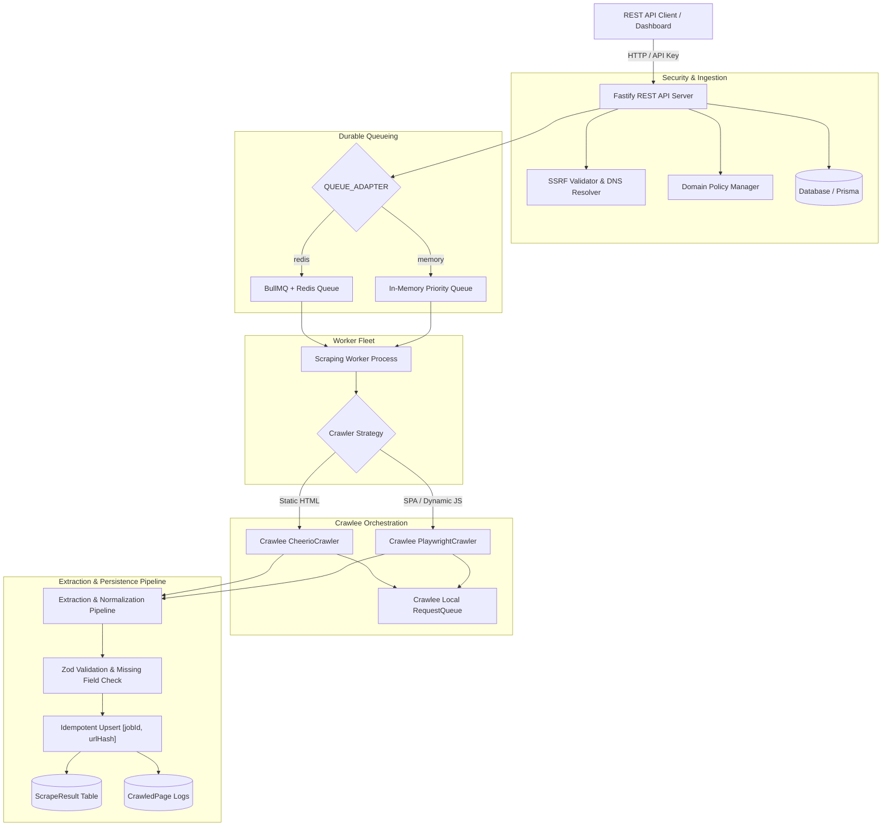

# Production-Ready Web Scraping Platform

A resilient, scalable web scraping and crawling platform engineered with **Node.js**, **TypeScript (Strict Mode)**, **Crawlee**, **Playwright (Chromium)**, **Cheerio**, **Prisma ORM**, **BullMQ / Redis**, and **Fastify**.

Designed for high-volume crawling, anti-SSRF security, idempotent persistence, per-domain rate pacing, and zero-downtime queue resilience.

---

## 1. System Architecture



### Division of Queue Responsibilities
- **Application Job Queue (BullMQ / MemoryQueue)**: Durable, distributed job orchestration across worker processes, priorities, retry policies with exponential backoff & jitter, and crash recovery.
- **Crawlee RequestQueue**: Ephemeral in-crawl queue managing per-job URL frontiers, link discovery, and depth enforcement during an active crawl session.

---

## 2. Key Features

- **Multi-Strategy Crawling**:
  - `CHEERIO`: Extremely fast HTTP-based crawler using Cheerio. Zero browser overhead.
  - `PLAYWRIGHT`: Full Chromium browser crawler with memory-saving resource blocking (aborts unwanted fonts, media, and stylesheets).
  - `AUTO`: Intelligent heuristic detection that inspects page DOM structure (SPA root mount detection) before choosing whether browser rendering is strictly necessary.
- **Comprehensive SSRF Protection**:
  - Resolves domain to both IPv4 and IPv6 addresses before fetching.
  - Blocks loopback (`127.0.0.0/8`, `::1`), private networks (`10.0.0.0/8`, `172.16.0.0/12`, `192.168.0.0/16`, `fc00::/7`), link-local (`169.254.0.0/16`, `fe80::/10`), and cloud metadata (`169.254.169.254`, `169.254.170.2`, `metadata.google.internal`).
  - Blocks internal TLDs (`.local`, `.internal`, `.lan`, `.corp`).
  - Restricts protocols strictly to `http:` and `https:`.
- **Durable Database Persistence**:
  - Supports **SQLite `scrape.db` local file** (default zero-dependency setup) and **MySQL live database**.
  - Idempotent writes: results use composite unique constraints `[jobId, urlHash]`. Retrying a job or visiting the same URL multiple times updates the existing record rather than duplicating it.
- **Per-Domain Rate Pacing & Concurrency**:
  - Dynamic token-bucket delay (`minDelayMs`) and concurrency limiting (`maxConcurrency`) per target domain.
- **Robust Error Handling & Recovery**:
  - Orphaned job recovery upon service restarts.
  - Bounded exponential backoff with randomized jitter on transient failures.
- **API Security**:
  - Timing-safe API Key authentication via `x-api-key` or `Authorization: Bearer <key>`.

---

## 3. Tech Stack

| Component | Technology |
|---|---|
| Runtime | Node.js (v20+ / v22+ ESM) |
| Language | TypeScript 5.x (Strict mode) |
| Framework | Crawlee 3.x |
| Static Crawler | `@crawlee/cheerio` + Cheerio |
| Browser Crawler | `@crawlee/playwright` + Playwright Chromium |
| REST API | Fastify 5.x |
| Database ORM | Prisma 5.22.x |
| Database Options | SQLite (`file:./scrape.db`) or MySQL Live |
| Queue Options | BullMQ 6.x + Redis / In-Memory Priority Queue |
| Validation | Zod |
| Logger | Pino |
| Test Runner | Vitest |
| Containers | Docker & Docker Compose |

---

## 4. Quickstart Guide

### 1. Install Dependencies
```bash
npm install
```

### 2. Configure Environment
A default `.env` is already configured for instant local execution using SQLite (`scrape.db`) and in-memory queue:

```env
DATABASE_URL="file:./scrape.db"
PORT=3000
HOST="0.0.0.0"
API_KEY="dev-scrape-secret-key-2026"
QUEUE_ADAPTER="memory"
```

### 3. Initialize Database
```bash
npm run prisma:push
```

### 4. Run the Application
```bash
# Development mode with hot-reloading
npm run dev

# Or build and run production bundle
npm run build
npm start
```

The REST API server will listen at `http://localhost:3000`.

---

## 5. Running with Docker Compose (BullMQ + Multi-Worker Fleet)

To run a distributed scraping fleet with Fastify API, Redis, and multi-worker replicas:

```bash
docker compose up --build
```

To run with MySQL database instead of local SQLite:
```bash
docker compose --profile with-mysql up --build
```

---

## 6. Testing

The platform includes unit and integration tests using **Vitest**:

```bash
# Run all tests once
npm test

# Run tests in watch mode
npm run test:watch
```

Test coverage includes:
- SSRF prevention & IP range validation (`tests/ssrf.test.ts`)
- URL normalization & SHA-256 deduplication hashing (`tests/url-normalizer.test.ts`)
- Content, metadata, selector, JSON-LD, and validation pipeline (`tests/extraction.test.ts`)
- In-memory priority queue ordering & job cancellation (`tests/queue.test.ts`)
- Fastify REST API endpoints & authentication (`tests/api.test.ts`)
- Next.js Project Generator engine, JSX transformation, and packaging (`tests/generator.test.ts`)
- Next.js Generator REST API and download streams (`tests/conversion-api.test.ts`)
- Interactive Playground UI and Next.js tabs (`tests/playground-view.test.ts`)

---

## 7. Website Scraper → Next.js Project Generator

Convert any scraped website into a clean, modern, modular **Next.js 16 App Router project** with TypeScript, reusable React components, and local asset packaging.

### Key Capabilities
- **11-Stage Modular Pipeline**:
  1. `validate-input`: Validates options and job output availability.
  2. `load-scrape-snapshot`: Ingests crawled pages and raw HTML.
  3. `build-page-inventory`: Maps URLs to Next.js routes (`/`, `/about`, `/contact`) with collision handling.
  4. `resolve-assets`: Discovers and downloads images, SVGs, fonts, and stylesheets with SSRF filtering.
  5. `analyze-page-structure`: Parses DOM landmarks (`header`, `footer`, `nav`, `main`, `sections`).
  6. `identify-shared-components`: Analyzes cross-page DOM skeletons to extract shared `Header`, `Footer`, `Navigation`, and repeated sections.
  7. `generate-nextjs-files`: Generates Server/Client Components, layout files, `globals.css`, and configs.
  8. `install-or-resolve-dependencies`: Creates `package.json`, `tsconfig.json`, `next.config.mjs`, and `README.md`.
  9. `run-static-validation`: Audits TypeScript JSX syntax, route integrity, and `@/*` imports.
  10. `prepare-preview`: Indexes generated files for instant code browsing and inspection.
  11. `package-project`: Assembles a portable, production-ready `.zip` archive.
- **Interactive UI Playground**:
  - Visit `http://localhost:3000/playground` in your browser.
  - Submit any URL or select an existing scrape job.
  - Click **"Convert to Next.js"** in the top action bar or navigate to the **"Next.js Generator"** tab.
  - Customize conversion settings: Project Name, CSS Preservation vs. Tailwind CSS, Component Extraction Level, TypeScript, and Metadata.
  - Watch live progress tracking across all 11 stages.
  - Browse generated project files in the built-in two-pane code viewer and download the complete ZIP with one click.
- **Visual & Interaction Fidelity**:
  - Automatically translates HTML to clean JSX with camelCase attributes and style objects.
  - Rewrites internal links to use Next.js `<Link href="...">` components.
  - Classifies client-side interactions (modals, accordions, mobile menus) and attaches `'use client'` pragmas.
  - Aggregates external and inline CSS into `app/globals.css` with rewritten local asset paths.

### REST API Usage

#### 1. Fetch Job Conversion Preview
```bash
curl http://localhost:3000/api/v1/jobs/<JOB_ID>/conversion-preview \
  -H "x-api-key: dev-scrape-secret-key-2026"
```

#### 2. Start Project Conversion
```bash
curl -X POST http://localhost:3000/api/v1/conversions \
  -H "Content-Type: application/json" \
  -H "x-api-key: dev-scrape-secret-key-2026" \
  -d '{
    "jobId": "<JOB_ID>",
    "projectName": "my-scraped-site",
    "useTypeScript": true,
    "cssStrategy": "preserve",
    "componentExtraction": "moderate",
    "preserveInteractions": true,
    "preserveSeo": true
  }'
```

#### 3. Monitor Progress & Inspect Files
```bash
curl http://localhost:3000/api/v1/conversions/<CONVERSION_ID> \
  -H "x-api-key: dev-scrape-secret-key-2026"
```

#### 4. Download Complete Next.js ZIP
```bash
# Via cURL with header:
curl -O -J http://localhost:3000/api/v1/conversions/<CONVERSION_ID>/download \
  -H "x-api-key: dev-scrape-secret-key-2026"

# Or directly in browser / URL bar:
http://localhost:3000/api/v1/conversions/<CONVERSION_ID>/download?api_key=dev-scrape-secret-key-2026
```

---

## 8. API Usage Example

### Create a Scraping Job
```bash
curl -X POST http://localhost:3000/api/v1/jobs \
  -H "Content-Type: application/json" \
  -H "x-api-key: dev-scrape-secret-key-2026" \
  -d '{
    "name": "Book Scrape",
    "targetUrl": "https://books.toscrape.com/",
    "strategy": "AUTO",
    "maxDepth": 1,
    "maxPages": 5,
    "extractionConfig": {
      "extractMetadata": true,
      "extractHeadings": true,
      "customSelectors": [
        { "name": "prices", "selector": ".price_color", "multiple": true }
      ]
    }
  }'
```

### Check Job Status
```bash
curl http://localhost:3000/api/v1/jobs/<JOB_ID> \
  -H "x-api-key: dev-scrape-secret-key-2026"
```

### Retrieve Extracted Results
```bash
curl http://localhost:3000/api/v1/jobs/<JOB_ID>/results \
  -H "x-api-key: dev-scrape-secret-key-2026"
```

For full endpoint documentation, see [API.md](file:///c:/Users/zahee/Desktop/Scraperoverall/API.md).

